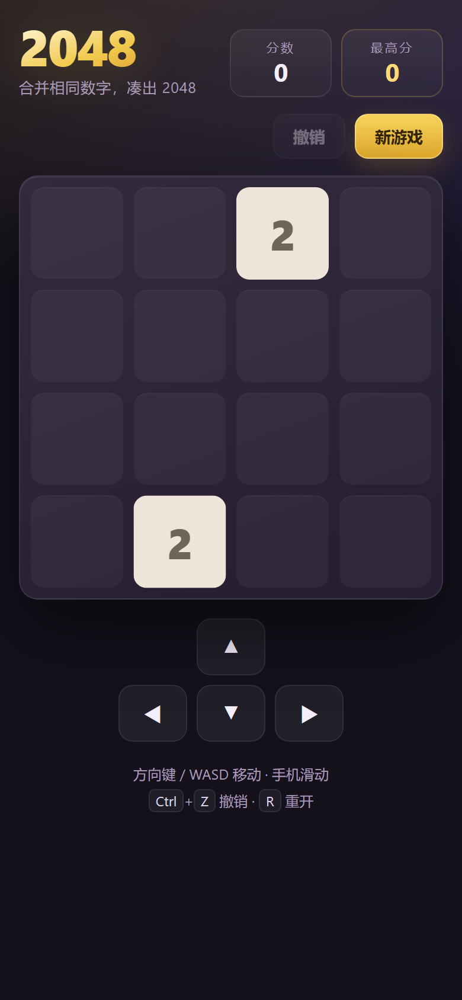

# 2048（浏览器版）

一个不用安装、不用联网、零依赖的 2048。双击 `index.html` 就能在浏览器里玩，键盘、鼠标拖动、手机滑动都支持。



## 开始玩

1. 双击 `index.html`（或拖进浏览器窗口）。
2. 用方向键 / WASD 移动方块，手机上直接滑动棋盘。
3. 相同的数字撞在一起会合并，凑出 **2048** 即达成目标，之后还可以继续挑战更大的数字。

> 不需要本地服务器，`file://` 直接打开即可；核心只有 `index.html` 和 `game-core.js` 两个文件。

## 操作

| 操作 | 方式 |
| --- | --- |
| 移动方块 | 方向键、`W` `A` `S` `D`、在棋盘上滑动（鼠标拖动同样有效）、窄屏下的屏幕方向键 |
| 撤销一步 | 点击「撤销」或 `Ctrl / Cmd + Z`（最多回退 20 步） |
| 重开一局 | 点击「新游戏」或按 `R` |
| 继续挑战 | 达成 2048 后在弹层里点「继续挑战」 |
| 撤销后继续 | 游戏结束的弹层里点「撤销一步」，回到上一步继续玩 |

## 特性

- **规则完整**：同一步里每个方块只合并一次，`[2,2,2,2]` 一步变成 `[4,4]`，不连锁。
- **动画**：方块滑动、合并脉冲、新方块弹出，均使用 CSS 变换，并在 `prefers-reduced-motion` 下自动关闭。
- **计分与最高分**：分数实时更新、合并有得分飘字；最高分存入 `localStorage`（键名 `dsh-2048-best`），存储不可用时自动降级为仅本局有效。
- **撤销**：最多回退 20 步，游戏结束后也可以先撤销再继续。
- **胜利与结束**：首次合出 2048 弹出胜利层，只弹一次；无路可走时显示结束层，可直接撤销一步。
- **响应式**：棋盘宽度随窗口缩放，手机/平板/桌面都可用；窄屏会自动出现屏幕方向键。
- **可访问性**：按钮有文字标签、分数变化有 `aria-live` 播报、可见键盘焦点、纯键盘可完成整局。
- **零外部资源**：没有 CDN、没有网络请求、没有构建步骤，断网也能玩。

## 文件说明

| 文件 | 作用 |
| --- | --- |
| `index.html` | 页面结构、全部样式、界面交互与动画（双击即玩） |
| `game-core.js` | 纯规则引擎：移动、合并、生成、判负、撤销，不操作 DOM |
| `tests.html` | 引擎测试台，浏览器打开即可看到逐条通过/失败（已加 `noindex`） |
| `preview.png` | 手机尺寸下的界面截图 |
| `.nojekyll` | 空文件，告诉 GitHub Pages 跳过 Jekyll 处理，原样发布静态文件 |

## 部署到 GitHub Pages

本项目是纯静态页面，推到 GitHub 后由 Pages 托管，**不需要构建、不需要服务器**。

### 1. 推到 GitHub

```bash
git init
git add .
git commit -m "2048 browser game"
git branch -M main
git remote add origin https://github.com/<你的用户名>/<仓库名>.git
git push -u origin main
```

> 仓库名用 `<你的用户名>.github.io` 时，网址是 `https://<你的用户名>.github.io/`；用其他名字则是项目站点，网址为 `https://<你的用户名>.github.io/<仓库名>/`。本项目全部使用相对路径，两种方式都能直接打开。

### 2. 开启 Pages

仓库 **Settings → Pages → Build and deployment**：

1. Source 选 **Deploy from a branch**；
2. Branch 选 `main`，目录选 `/ (root)`；
3. 点 **Save**，等 1–2 分钟，页面顶部会显示访问地址。

### 3. 上线后验收

- 打开 `https://<你的用户名>.github.io/<仓库名>/`（用户站点则不带仓库名）能正常开局、移动、撤销；
- 用手机蜂窝网络访问一次，确认滑动和屏幕方向键可用；
- `curl.exe -I https://…/game-core.js` 返回 200，且 `Content-Type` 为 `application/javascript`；
- 刷新页面后最高分仍在（`localStorage` 按域名隔离，从本地 `file://` 玩出的最高分不会带过来，属正常现象）。

### 4. 绑定自己的域名（可选）

1. 在 Pages 设置的 **Custom domain** 填 `game.example.com` → **Save**；
2. 到域名 DNS 添加 `CNAME` 记录指向 `<你的用户名>.github.io`（顶级域名用 A 记录指向 GitHub Pages 的 IP、`www` 用 CNAME，具体 IP 以 GitHub 官方文档为准）；
3. DNS 生效后回到 Pages 勾选 **Enforce HTTPS**；
4. 仓库里会生成 `CNAME` 文件，保持提交、不要删除。

### 5. 更新与注意事项

- 每次推送 `main` 都会自动重新发布，通常 1–2 分钟生效；
- GitHub Pages 固定 `Cache-Control: max-age=600` 且不可自定义，刚更新时最多约 10 分钟内可能看到旧版，强制刷新即可；
- `.js` 由 Pages 以正确 MIME 返回，不需要额外配置；
- `tests.html` 已加 `noindex`，即使随仓库发布也不会进入搜索引擎；若完全不想公开它，可把它移出仓库，或改用 `docs/` 目录只发布游戏文件；
- GitHub Pages 的免费方案通常要求仓库公开（私有仓库的 Pages 取决于账户套餐）；
- 分享卡片：`og:title` / `og:description` 已就绪；若想让链接卡片带图，可在部署后把 `og:image` 指向 `https://你的域名/preview.png` 的绝对地址（建议另做一张约 1200×630 的横图），并补上 `og:url`。


## 自测

浏览器打开 `tests.html`，全部通过时页面标题为 `TESTS: 18 passed, 0 failed`。

覆盖的规则点：初始两方块、四个方向的压缩与合并、每步只合并一次、得分累加、随机生成只落空位、无移动不生成/不记历史、`canMove` 的三种情况、撤销与历史上限、胜利只触发一次、结束判定、新游戏保留最高分、最高分持久化、非法输入安全返回。

## 开发调试参数（可选）

这些参数**只在本地生效**：`file://` 直接打开，或用 `localhost` / `127.0.0.1` 访问时。部署到线上（如 GitHub Pages）后，即使链接里带了这些参数也会被忽略，页面照常开新局。

| 参数 | 作用 |
| --- | --- |
| `?demo=mid` / `?demo=win` / `?demo=over` | 载入固定的中局 / 胜利 / 结束局面，方便看界面 |
| `?keys=ArrowLeft,ArrowUp` | 依次派发按键事件，用来验证键盘交互 |
| `?debug=1` | 把视口、棋盘尺寸、方块数与棋面写入 `<html data-debug>` |

示例：`index.html?demo=win`、`index.html?debug=1&keys=ArrowLeft,ArrowDown`。

## 说明与限制

- 只保存最高分，不保存进行中的棋局；刷新页面会重新开始一局。
- 最高分按**域名**分别保存：本地 `file://`、`*.github.io`、自定义域名之间互不共享。
- 在 `file://` 下若浏览器禁用了本地存储，最高分只在当前页面有效（不影响游玩）。
- 界面语言为中文，棋盘固定 4×4；引擎的 `size` 参数已预留，但界面按 4×4 渲染。
